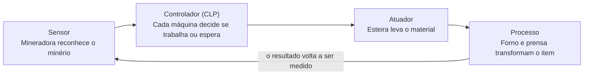

# Ferrugem — Fábrica · Documentação do projeto

Versão 13 · novembro de 2026 · autor: Pedro Otávio Antoniazzi

**Jogar agora:** [pedrootavioantoniazzi-dev.github.io/Ferrugem](https://pedrootavioantoniazzi-dev.github.io/Ferrugem/) · **Trailer:** [youtu.be/cyXfUx24iXM](https://youtu.be/cyXfUx24iXM)

## Sumário

1. [Apresentação](#apresentação)
2. [Como jogar](#como-jogar)
3. [Automação industrial no jogo](#automação-industrial-no-jogo)
4. [Máquinas](#máquinas)
5. [Itens e cadeias de produção](#itens-e-cadeias-de-produção)
6. [Progressão](#progressão)
7. [Recursos do jogo](#recursos-do-jogo)
8. [Como foi feito](#como-foi-feito)
9. [Roteiro para a feira](#roteiro-para-a-feira)
10. [Histórico de versões](#histórico-de-versões)
11. [Créditos, links e referência técnica](#créditos-links-e-referência-técnica)

## Apresentação

**Ferrugem — Fábrica** é um jogo educativo e gratuito, que roda no navegador do computador e do celular. Nele o jogador monta uma fábrica automatizada do zero e aprende, na prática, como funcionam a automação industrial e a Indústria 4.0.

O jogador começa com $650. Ele extrai minérios, transforma em produtos cada vez mais complexos e liga as máquinas com esteiras para que trabalhem sozinhas. O papel dele não é produzir cada peça, e sim **planejar, conectar e melhorar o sistema**. A partida vai de um simples lingote de ferro até carros elétricos, trens, aviões e foguetes.

**Para quem é:** estudantes do ensino fundamental e médio, professores e qualquer pessoa curiosa sobre como uma indústria funciona. Não precisa saber nada antes: um tutorial de 8 passos ensina o começo.

**Onde jogar:**

- Site público: [pedrootavioantoniazzi-dev.github.io/Ferrugem](https://pedrootavioantoniazzi-dev.github.io/Ferrugem/)
- Código-fonte: [github.com/pedrootavioantoniazzi-dev/Ferrugem](https://github.com/pedrootavioantoniazzi-dev/Ferrugem)
- Sem internet: basta abrir o arquivo `index.html` em qualquer navegador.

**O jogo em números (versão 13):**

| O quê | Quantidade |
| --- | --- |
| Máquinas diferentes | 34 |
| Itens e materiais | 36 |
| Tipos de minério no mapa | 6 (ferro, cobre, carvão, areia, petróleo e bauxita) |
| Tamanho do mapa | 180 × 130 quadrados |
| Níveis do jogador | 40 |
| Níveis de melhoria de cada máquina | 10 |
| Contratos fixos | 45 (depois deles, os contratos continuam sem fim) |
| Conquistas | 1.619 |
| Tamanho do jogo | um único arquivo de cerca de 110 KB, sem bibliotecas |

## Como jogar

A primeira fábrica fica pronta em cerca de 1 minuto: uma linha de ferro que vende lingotes sozinha. Na primeira vez, o jogo pergunta se a pessoa está no **celular** ou no **computador** e ajusta a tela.

**O primeiro minuto (o mesmo caminho do tutorial):**

1. Coloque uma **Mineradora** em cima dos cristais laranja (ferro).
2. Coloque um **Gerador** perto. Ele queima carvão e dá energia para as máquinas.
3. Coloque outra mineradora no carvão (cristais cinza) e ligue ao gerador com **Esteiras**. Arraste o mouse ou o dedo para desenhar a esteira.
4. Coloque um **Forno** e leve o minério de ferro até ele por esteira. A esteira precisa apontar para dentro da máquina.
5. Ligue a saída do forno a um **Mercado** com outra esteira. Cada lingote vendido dá dinheiro e experiência.
6. No nível 2 a **Prensa** é liberada: 2 lingotes viram 1 chapa, que vale bem mais.

Máquinas encostadas também entregam itens direto uma para a outra, sem esteira.

**Controles no computador:**

| Ação | Como fazer |
| --- | --- |
| Mover a câmera | W A S D (ou setas), ou arrastar com a ferramenta Selecionar |
| Zoom | Roda do mouse, ou + e − |
| Escolher máquina | Barra de baixo, teclas 1 a 9 e 0, ou o botão 🏗 Mais |
| Girar a esteira | Tecla R, ou o botão ⟳ |
| Ver uma máquina | Clicar nela (tecla Q volta para Selecionar) |
| Melhorar a máquina selecionada | Botão ⬆ Melhorar, ou tecla U |
| Remover | Botão direito do mouse, ou tecla X e clicar |
| Pausar | Espaço |
| Minimapa | Tecla M, ou o botão 🗺 |
| Velocidade do tempo | Botões 1x, 3x e 8x |

**Controles no celular:**

| Ação | Como fazer |
| --- | --- |
| Mover a câmera | Arrastar um dedo com a ferramenta Selecionar |
| Zoom | Pinça com dois dedos, ou + e − |
| Escolher máquina | Botão 🏗 Máquinas (grade separada por fases) |
| Colocar uma máquina | Tocar no mapa; arrastando o dedo, a prévia acompanha e a máquina é colocada ao soltar |
| Desenhar esteira | Escolher Esteira e arrastar o dedo |
| Ver uma máquina | Tocar nela: o painel abre como uma gaveta embaixo, com ✕ para fechar |
| Menu (pausa, velocidade, conquistas, salvar, som, gráficos) | Botão ☰ no topo |
| Ver como fazer o contrato | Tocar no quadro do contrato |

## Automação industrial no jogo

Cada peça do jogo representa uma parte real de uma linha de produção automatizada. Jogando, o aluno vê a automação funcionando em vez de só ler sobre ela.

**O que é automação industrial:** o uso de tecnologias e sistemas de controle, como computadores e robôs, para operar equipamentos e processos sem intervenção humana constante. Sensores identificam informações como temperatura, pressão, velocidade e posição. Esses dados vão para os CLPs (Controladores Lógicos Programáveis), que decidem o que fazer. Os comandos seguem para os atuadores, que movimentam peças, abrem válvulas e controlam máquinas.

No jogo, as máquinas fazem esse ciclo sozinhas o tempo todo: o jogador só monta e melhora o sistema.

| Conceito real | Como aparece no jogo |
| --- | --- |
| **Sensor** | A Mineradora identifica qual minério está embaixo dela e só extrai aquele tipo |
| **Atuador** | As Esteiras movimentam o material de uma etapa para a outra, sem ninguém carregar |
| **CLP (controlador)** | Cada máquina decide sozinha: sem matéria-prima, sem energia ou com a saída cheia, ela para e espera |
| **Sinalização de estado** | A luz de cada máquina: verde funcionando, amarela sem material, vermelha sem energia ou bloqueada |
| **Fluxo de produção** | Cadeias como minério → forno → prensa → montadora → mercado |
| **Gargalo** | Uma máquina lenta segura a linha toda; melhorar só ela já aumenta a produção |
| **Energia** | Geradores a carvão, painéis solares, turbinas eólicas e reator de fusão; sem energia suficiente, tudo fica mais lento |
| **Custo de investimento** | Cada máquina igual comprada fica 5% mais cara, e as melhorias custam cada vez mais |
| **Produtividade** | Cada nível de melhoria deixa a máquina 40% mais rápida |
| **Estoque intermediário** | O Armazém guarda itens para a linha não parar quando falta ou sobra material |
| **Indústria 4.0** | Robôs, eletrônica, motores elétricos, baterias e veículos elétricos nas fases avançadas |

**Vantagens da automação que o jogo mostra:** menor dependência do trabalho manual e maior produtividade. Uma linha bem montada produz sem parar.

**Desvantagens que o jogo também mostra:** alto custo e a necessidade de pessoas especializadas. As máquinas avançadas custam caro, consomem muita energia e exigem planejamento. A automação não resolve tudo sozinha: uma linha mal planejada trava.

**No Vale do Taquari:** o jogo cita empresas da região que usam automação, como a Fruki (Lajeado), a Atlas Calçados (Teutônia) e a Baldo S.A. Essas informações aparecem na janela **Automação** e nas curiosidades "Você sabia?".

**Curiosidades dentro do jogo:** cada máquina tem um "Você sabia?" ligado ao tema, como sensores, atuadores, CLPs, energia solar e eólica, siderurgia, IHM (Interface Homem-Máquina), robótica, fusão nuclear e transportes.

## Máquinas

São 34 máquinas, liberadas do nível 1 ao 33. O custo da tabela é o da primeira unidade: cada máquina igual comprada depois fica 5% mais cara (a esteira não entra nessa regra). A coluna Energia mostra o consumo; as fontes de energia mostram o que geram.

| Nível | Máquina | Custo | Energia | O que faz |
| --- | --- | --- | --- | --- |
| 1 | Esteira | $3 | — | Leva itens de uma máquina para outra |
| 1 | Mineradora | $85 | 20 kW | Extrai ferro, cobre, carvão, areia ou bauxita (não petróleo) |
| 1 | Forno | $130 | 30 kW | Minério vira lingote; areia vira vidro; bauxita vira alumínio |
| 1 | Gerador | $100 | gera 80 kW | Queima 1 carvão a cada 10 s |
| 1 | Mercado | $50 | — | Vende qualquer item que chegar |
| 2 | Prensa | $190 | 40 kW | 2 lingotes viram 1 chapa |
| 2 | Armazém | $70 | — | Guarda até 200 itens por nível e solta aos poucos |
| 3 | Trefiladora | $160 | 30 kW | 1 lingote de cobre vira 2 fios |
| 4 | Painel solar | $260 | gera 35 kW | Energia sem combustível |
| 5 | Montadora | $320 | 60 kW | Faz circuitos e engrenagens |
| 6 | Siderúrgica | $450 | 70 kW | Ferro + carvão viram aço |
| 7 | Eletrônica | $600 | 80 kW | Vidro + circuito viram tela |
| 8 | Fáb. de motores | $800 | 100 kW | Engrenagem + fios + aço viram motor |
| 9 | Turbina eólica | $500 | gera 60 kW | Energia sem combustível |
| 10 | Linha de robôs | $1.500 | 150 kW | Motor + circuitos + aço viram robô |
| 11 | Bomba de petróleo | $600 | 40 kW | Extrai petróleo das poças escuras |
| 11 | Refinaria | $900 | 80 kW | Petróleo vira plástico |
| 12 | Fáb. de baterias | $1.400 | 100 kW | Chapa de cobre + plástico viram bateria |
| 13 | Fáb. de carros | $3.000 | 200 kW | Monta carro elétrico |
| 14 | Reator de fusão | $8.000 | gera 500 kW | Muita energia sem combustível |
| 15 | Petroquímica | $2.500 | 120 kW | Petróleo vira borracha |
| 16 | Fáb. de pneus | $3.200 | 120 kW | Borracha + aço viram pneu |
| 17 | Laminadora | $3.500 | 140 kW | Lingote de alumínio vira chapa |
| 18 | Fáb. de bicicletas | $4.500 | 120 kW | Monta bicicleta |
| 19 | Fáb. de patinetes | $5.500 | 140 kW | Monta patinete elétrico |
| 20 | Fáb. de motos | $7.000 | 180 kW | Monta moto |
| 21 | Fáb. de caminhões | $9.000 | 220 kW | Monta caminhão |
| 22 | Fáb. de drones | $10.000 | 160 kW | Monta drone |
| 23 | Fáb. de ônibus | $12.000 | 260 kW | Monta ônibus |
| 24 | Fáb. de trilhos | $13.000 | 200 kW | Aço vira trilho |
| 26 | Fáb. de trens | $18.000 | 320 kW | Monta trem |
| 28 | Estaleiro | $24.000 | 360 kW | Constrói navio |
| 30 | Fáb. de aviões | $32.000 | 420 kW | Monta avião |
| 33 | Base de foguetes | $50.000 | 600 kW | Monta foguete, o item mais valioso ($9.000) |

A energia que as máquinas usam cresce 25% a cada nível de melhoria, e a que os geradores produzem cresce 50%.

## Itens e cadeias de produção

Tudo começa em 6 minérios e termina em 11 veículos. Quanto mais etapas um item tem, mais ele vale no Mercado: o minério de ferro vale $2, o foguete vale $9.000.

**Minérios (no mapa):** ferro (cristais laranja), cobre (azul-esverdeados), carvão (cinza), areia (bege), bauxita (vermelhos) e petróleo (poças escuras, só com a Bomba de petróleo).

| Item | Valor | Onde é feito | Receita | Tempo |
| --- | --- | --- | --- | --- |
| Lingote de ferro | $8 | Forno | 1 minério de ferro | 2 s |
| Lingote de cobre | $9 | Forno | 1 minério de cobre | 2 s |
| Vidro | $9 | Forno | 1 areia | 2 s |
| Lingote de alumínio | $12 | Forno | 2 bauxitas | 3 s |
| Chapa de ferro | $22 | Prensa | 2 lingotes de ferro | 3 s |
| Chapa de cobre | $25 | Prensa | 2 lingotes de cobre | 3 s |
| Fio de cobre | $7 (sai 2) | Trefiladora | 1 lingote de cobre | 2 s |
| Chapa de alumínio | $35 | Laminadora | 2 lingotes de alumínio | 3 s |
| Engrenagem | $55 | Montadora | 2 chapas de ferro | 3 s |
| Circuito | $60 | Montadora | 1 chapa de ferro + 3 fios | 4 s |
| Aço | $35 | Siderúrgica | 2 lingotes de ferro + 1 carvão | 4 s |
| Tela | $140 | Eletrônica | 2 vidros + 1 circuito | 5 s |
| Motor | $200 | Fáb. de motores | 1 engrenagem + 4 fios + 1 aço | 6 s |
| Robô | $700 | Linha de robôs | 1 motor + 2 circuitos + 2 aços | 8 s |
| Plástico | $24 | Refinaria | 2 petróleos | 3 s |
| Borracha | $18 | Petroquímica | 2 petróleos | 3 s |
| Bateria | $150 | Fáb. de baterias | 2 chapas de cobre + 1 plástico | 5 s |
| Pneu | $110 | Fáb. de pneus | 2 borrachas + 1 aço | 4 s |
| Trilho | $160 | Fáb. de trilhos | 3 aços | 4 s |
| Bicicleta | $600 | Fáb. de bicicletas | 1 aço + 2 pneus + 2 engrenagens | 6 s |
| Patinete elétrico | $750 | Fáb. de patinetes | 2 chapas de alumínio + 1 bateria + 2 pneus | 6 s |
| Drone | $900 | Fáb. de drones | 2 plásticos + 1 bateria + 2 circuitos + 1 motor | 7 s |
| Moto | $1.100 | Fáb. de motos | 1 motor + 2 pneus + 2 aços + 1 bateria | 8 s |
| Carro elétrico | $2.200 | Fáb. de carros | 1 motor + 2 baterias + 2 aços + 1 tela | 10 s |
| Caminhão | $2.200 | Fáb. de caminhões | 2 motores + 6 pneus + 6 aços | 12 s |
| Ônibus | $2.600 | Fáb. de ônibus | 2 motores + 6 pneus + 6 chapas de alumínio + 2 telas | 14 s |
| Navio | $3.200 | Estaleiro | 20 aços + 4 motores + 2 telas | 24 s |
| Avião | $4.800 | Fáb. de aviões | 20 chapas de alumínio + 4 motores + 10 circuitos + 4 telas | 28 s |
| Trem | $5.200 | Fáb. de trens | 4 motores + 10 trilhos + 8 chapas de alumínio + 6 circuitos | 20 s |
| Foguete | $9.000 | Base de foguetes | 30 chapas de alumínio + 20 circuitos + 10 baterias + 6 motores | 40 s |

Os minérios também podem ser vendidos direto: ferro, cobre e bauxita valem $2, petróleo $3, carvão e areia $1. Os tempos são da máquina no nível 1; cada melhoria reduz o tempo.

**Exemplo de cadeia completa (o carro elétrico):** ferro e carvão viram aço; cobre vira fios e chapas; areia vira vidro, que com um circuito vira tela; petróleo vira plástico, que com chapa de cobre vira bateria. Engrenagem, fios e aço viram motor. Por fim, motor, baterias, aço e tela viram o carro. São 5 minérios e 12 tipos de máquina trabalhando juntos.

## Progressão

O jogador sobe de nível vendendo: cada $1 vendido dá 1 ponto de experiência (⭐), e cada contrato concluído dá a recompensa em dinheiro e a mesma quantidade em experiência.

**Níveis do jogador (1 a 40).** O nível 2 chega com 150 pontos, o 5 com 2.500, o 10 com 36.000, o 15 com 200.000, o 20 com 800.000, o 30 com 12,8 milhões e o 40 com 206 milhões. Cada nível traz:

- novas máquinas liberadas, com a explicação de cada uma no aviso de nível;
- +3% no preço de venda de tudo;
- um nível a mais de melhoria permitido para as máquinas (até o máximo de 10);
- esteiras 50% mais rápidas no nível 7 e duas vezes mais rápidas no nível 12.

**Melhorias de máquina (nível 1 a 10).** Toque na máquina e em ⬆ Melhorar. Cada nível custa 60% do preço da máquina vezes o nível atual, e a máquina passa a valer mais. Os efeitos por nível:

| Tipo de máquina | Efeito de cada nível |
| --- | --- |
| Mineradoras e fábricas | +40% de velocidade, +25% de consumo de energia |
| Gerador, painel solar, turbina e reator | +50% de energia gerada |
| Armazém | +200 itens de capacidade |
| Mercado | +10% no preço de venda |

Ao remover uma máquina, o jogador recebe de volta metade do que pagou nela, contando as melhorias.

**Preço crescente.** Cada máquina igual comprada deixa a próxima 5% mais cara. A mineradora custa $85, depois $89, $94, $98 e assim por diante. A barra mostra quantas o jogador já tem de cada uma ("Mineradora ×2").

**Contratos.** O quadro do contrato pede uma quantidade de um item, mostra o caminho para fazer ("Como fazer") e tem o botão 📍 Ver cristais, que leva a câmera até o minério certo. São 45 contratos fixos, de "10 lingotes de ferro por $150" até "10 foguetes por $2 milhões". Depois deles os contratos continuam sem fim, 50% maiores a cada rodada.

**Conquistas (1.619).** A tela 🏆 tem abas:

| Aba | Quantas | Exemplos |
| --- | --- | --- |
| Destaques | 26 | Primeira venda, Explorador, Um Sol na Terra, Lenda da indústria |
| Vendas | 540 | Vender de 1 a 100 mil unidades de cada item |
| Fábricas | 376 | Ter de 1 a 100 unidades de cada máquina |
| Melhorias | 297 | Ter cada máquina nos níveis 2 a 10 |
| Dinheiro | 68 | Ter ou ganhar de $1 mil até $10 trilhões |
| Níveis | 39 | Chegar a cada nível, do 2 ao 40 |
| Contratos | 200 | Concluir de 1 a 200 contratos |
| Outras | 73 | Tempo de jogo, cristais renascidos, tipos de item vendidos, frota de veículos |

Cada conquista dá um prêmio em dinheiro, e a tela mostra o progresso até a próxima.

**Cristais que renascem.** Quando um quadrado de minério se esgota, o chão fica rachado e o cristal volta a crescer aos poucos. Depois de 10 minutos de tempo de jogo ele está cheio de novo. O painel da mineradora mostra quanto falta ("🌱 Os cristais voltam em 4 min").

## Recursos do jogo

O jogo funciona igual no computador e no celular, salva sozinho e não precisa de conta nem de internet depois de aberto.

| Recurso | Como funciona |
| --- | --- |
| **Modo computador** | Barra com as 10 primeiras máquinas e o botão 🏗 Mais; atalhos de teclado; botões de velocidade, salvar e conquistas no topo |
| **Modo celular** | Topo numa linha só com o menu ☰; barra com Selecionar, Remover, Esteira e 🏗 Máquinas; contrato recolhível; painel da máquina como gaveta embaixo |
| **Escolha do modo** | Na primeira vez o jogo pergunta "Celular ou Computador?" e lembra a resposta; dá para trocar no menu |
| **Salvamento automático** | Salva no navegador a cada 15 segundos e ao fechar a página; botão Salvar para salvar na hora |
| **🔗 Link do jogo** | Transforma o jogo inteiro num link compactado (cerca de 1.300 caracteres para uma fábrica grande). Abrindo o link em outro aparelho, o jogo continua de lá. Se o aparelho já tiver outro jogo, ele pergunta antes de substituir |
| **Tutorial** | 8 passos com círculos no mapa mostrando onde construir; pode ser refeito pelo menu |
| **Dicas "Como usar"** | Na primeira vez que cada máquina é colocada, aparece o que ela faz, o que entra e o que sai, com uma curiosidade "Você sabia?" |
| **🗺 Minimapa** | Mostra o mapa inteiro com as jazidas e as máquinas; tocar nele leva a câmera até o ponto |
| **🏆 Conquistas** | Tela com abas, contagem por categoria e progresso de cada série |
| **Sons** | Efeitos criados pelo próprio navegador (construir, remover, melhorar, subir de nível, conquista, contrato, falta de dinheiro); botão 🔊 / 🔇 para desligar |
| **⚡ Gráficos leves** | Tira nuvens, árvores, fumaça e faíscas e limita a 30 quadros por segundo. Liga sozinho quando o computador é lento; dá para trocar no menu ☰ |
| **Efeitos visuais** | "+$" subindo dos mercados, faíscas ao construir, estrelas ao melhorar, veículos saindo dos mercados quando são vendidos |
| **Contas online e Top global** | Prontos no código, mas desligados: só funcionam depois de configurar um projeto Firebase |

**Sem internet:** o jogo inteiro é um arquivo só. Copiado num pen drive, ele abre direto no navegador, o que é útil numa feira com Wi-Fi ruim.

## Como foi feito

O jogo inteiro é um único arquivo `index.html` de cerca de 110 KB, escrito em HTML, CSS e JavaScript puro, sem nenhuma biblioteca. Todo o desenho é feito por código num `<canvas>`: não há nenhuma imagem pronta.

| Parte | Como funciona |
| --- | --- |
| **Desenho** | Canvas 2D. Máquinas, itens, esteiras, árvores e efeitos são desenhados com formas e animações a cada quadro |
| **Mapa** | Grade de 180 × 130 quadrados de 32 pixels. As jazidas são geradas sempre nos mesmos lugares |
| **Simulação** | Roda em passos fixos de 0,05 segundo, separada do desenho. Nas velocidades 3x e 8x, só roda mais passos por quadro |
| **Dados do jogo** | Tabelas no código: máquinas (preço, energia, nível), itens (nome, valor, cor), receitas e contratos. Uma máquina nova é basicamente uma linha nova nessas tabelas |
| **Esteiras** | Cada esteira sabe para onde aponta e quem a alimenta; o desenho vira curva, T ou cruzamento sozinho |
| **Salvamento** | O estado do jogo vira texto (JSON) guardado no navegador. Se o navegador bloquear o armazenamento, o jogo continua funcionando só na memória |
| **Link do jogo** | O salvamento é compactado (deflate) e transformado em texto seguro para links (base64). Ao abrir, o jogo confere os dados e descarta o que for inválido |
| **Sons** | Gerados na hora pela Web Audio API, sem arquivos de áudio |
| **Desempenho** | Só desenha o que aparece na tela; o chão é uma imagem pequena ampliada; o modo leve liga sozinho em computador fraco |
| **Celular** | Toques, arrasto e pinça tratados à parte; a interface muda de layout no modo celular |

**Testes automáticos.** Cada versão foi testada com o Playwright, que abre o jogo num navegador Chromium controlado por código. Os testes montam fábricas completas e conferem as vendas; simulam celulares (iPhone SE, iPhone 13, Galaxy S9+) com toque e pinça; conferem se nenhum painel cobre outro; testam o link do jogo entre vários aparelhos; e verificam que não há erros no console.

**Teste de desempenho.** Num computador simulado 6 vezes mais lento, com uma fábrica de 236 construções em tela 1366 × 768, a versão 12 rodava a 11 quadros por segundo. A versão 13 roda a 26, e a 44 com os gráficos leves. O tempo de desenho de cada quadro caiu de 44,6 ms para 6,4 ms.

**Publicação.** O código fica no GitHub, e o GitHub Pages publica o site de graça, sem anúncios nem selos. Cada mudança enviada ao repositório atualiza o site em 1 ou 2 minutos.

**Ferramentas.** O jogo foi desenvolvido com a ajuda do Claude, um assistente de inteligência artificial da Anthropic, usado para escrever o código, os testes automáticos e esta documentação a partir das ideias e dos pedidos do autor.

## Roteiro para a feira

A melhor forma de apresentar o jogo é deixar o visitante construir a própria linha de produção em 2 minutos, enquanto você explica o que cada peça representa na indústria.

**Fala de 1 minuto (para quem está passando):**

> Esse é o Ferrugem, um jogo que eu fiz para ensinar automação industrial. Você monta uma fábrica que funciona sozinha: a mineradora é o sensor, que reconhece o minério; a esteira é o atuador, que leva o material; e cada máquina decide sozinha quando trabalhar, como um CLP. Você começa fazendo lingote de ferro e vai até carro elétrico, trem e foguete. Quer tentar montar a primeira linha?

**Fala de 3 minutos (para quem parou para ouvir):**

1. **O problema (30 s):** automação industrial é um assunto importante, mas difícil de visualizar só lendo. O jogo deixa a pessoa ver uma fábrica funcionando e montar a sua.
2. **A ideia (30 s):** o jogador não produz cada peça; ele planeja e conecta as máquinas. É exatamente o papel de quem trabalha com automação.
3. **A ponte com a indústria (1 min):** sensores, atuadores e CLPs aparecem como mineradora, esteira e máquinas que param sozinhas. Energia, gargalos e custo de investimento também aparecem, e o jogo cita empresas do Vale do Taquari como Fruki, Atlas Calçados e Baldo.
4. **O tamanho do projeto (30 s):** 34 máquinas, 36 itens, 40 níveis e 1.619 conquistas, tudo num arquivo só, que roda no computador e no celular.
5. **O convite (30 s):** o link está no QR code; dá para jogar no seu celular agora.

**Demonstração ao vivo (cerca de 2 minutos):**

1. Abra o jogo e escolha **Computador** (ou Celular, se for mostrar no celular).
2. Siga o tutorial: mineradora no ferro, gerador, mineradora de carvão ligada ao gerador.
3. Coloque forno e mercado e ligue tudo com esteiras. Mostre a luz verde: "funciona sozinho, isso é automação".
4. Aperte **8x** e mostre o dinheiro subindo, o "+$" saindo do mercado e o contrato sendo concluído.
5. Clique no forno: mostre o painel com estado, energia e receitas, e use ⬆ **Melhorar**.
6. Desligue o gerador removendo-o: as máquinas ficam com luz vermelha. "Sem energia, a linha para."
7. Abra o 🗺 minimapa e a tela 🏆 de conquistas para mostrar o tamanho do jogo.

**Desafio para visitantes:** "Consegue vender 10 lingotes de ferro em 2 minutos?" É o primeiro contrato do jogo, e todo mundo consegue com o tutorial.

**Checklist antes da feira:**

- [ ] Abrir o site e conferir se o topo mostra a versão mais recente
- [ ] Copiar o `index.html` num pen drive (plano B sem internet)
- [ ] Imprimir um QR code com o link do site para os visitantes jogarem no celular
- [ ] Em cada computador da feira, clicar em **Novo jogo** para começar do zero
- [ ] Se o computador for fraco, ligar **⚡ Gráficos leves** no menu ☰
- [ ] Deixar um jogo avançado salvo como 🔗 link, para mostrar as fábricas de veículos sem esperar
- [ ] Testar o som e levar fone, ou desligar o som com 🔇
- [ ] Ensaiar a fala de 1 minuto e a demonstração

**Perguntas frequentes:**

| Pergunta | Resposta |
| --- | --- |
| Você fez o jogo sozinho? | Eu criei a ideia, as regras e todas as mudanças, e usei o Claude, uma inteligência artificial, para escrever o código e os testes comigo |
| Precisa instalar alguma coisa? | Não. Abre no navegador, no computador ou no celular |
| Funciona sem internet? | Sim. É um arquivo só; copiado num pen drive, abre direto |
| É de graça? | Sim, e o código é aberto no GitHub |
| O que o jogo ensina? | Como sensores, atuadores e controladores trabalham juntos, e como energia, gargalos, custos e produtividade afetam uma fábrica |
| Como o jogo salva? | No próprio navegador, a cada 15 segundos. Para levar para outro aparelho, use o 🔗 Link do jogo |
| Quanto tempo leva para zerar? | Chegar ao foguete leva horas; as 1.619 conquistas e os contratos sem fim fazem o jogo continuar depois disso |
| Quais linguagens foram usadas? | HTML, CSS e JavaScript, sem bibliotecas |
| Funciona em computador fraco? | Sim. O modo Gráficos leves liga sozinho quando o jogo fica lento |

## Histórico de versões

O jogo passou por 13 versões. A versão aparece no topo da tela (no celular, no menu ☰).

| Versão | Data | O que mudou |
| --- | --- | --- |
| v13 | 04/11/2026 | Desenho 7 vezes mais rápido, modo ⚡ Gráficos leves automático, menu ☰ também no computador, espaço livre para o selo da Netlify, publicação no GitHub |
| v12 | 03/11/2026 | 14 fábricas novas com veículos (bicicleta a foguete), bauxita e alumínio, borracha e pneus, 40 níveis, máquinas até o nível 10, 1.619 conquistas com abas, botão 🏗 Mais no computador |
| v11 | 27/10/2026 | Petróleo, refinaria, baterias, carro elétrico e reator de fusão; cristais que renascem; mapa 180 × 130; painel do celular em gaveta; sons; árvores, nuvens e efeitos; esteiras mais rápidas por nível |
| v10 | 27/10/2026 | 🔗 Link do jogo para levar o salvamento a outro aparelho; painel de máquina com botões fixos; barra do topo numa linha |
| v9 | 22/10/2026 | Contas online e Top global (prontos, aguardando configuração do Firebase) |
| v8 | 22/10/2026 | 20 conquistas, tela inicial "Celular ou Computador?", modo celular simplificado, barra do computador em duas linhas |
| v7 | 21/10/2026 | Mapa maior, areia e vidro, aço, telas, motores, robôs, turbina eólica, 10 níveis, minimapa, preço 5% maior a cada máquina igual |
| v6 | 21/10/2026 | "Como fazer" e 📍 Ver cristais nos contratos |
| v5 | 21/10/2026 | Dicas "Como usar" para cada máquina |
| v4 | 21/10/2026 | Níveis do jogador, melhorias de máquina, trefiladora, painel solar, montadora, 15 contratos, entrega direta entre máquinas |
| v3 | 21/10/2026 | Tutorial e painel posicionados abaixo da barra do topo, sem cobrir os botões |
| v2 | antes de 21/10/2026 | Esteiras ligadas com curvas, máquinas com visual realista, suporte a toque no celular, economia ajustada |
| v1 | antes de 21/10/2026 | Versão original: esteira, mineradora, forno, prensa, gerador, armazém e mercado, tutorial e contratos |

## Créditos, links e referência técnica

**Autor:** Pedro Otávio Antoniazzi (Nexora), com desenvolvimento assistido pelo Claude (Anthropic).

**🏅 Menção honrosa:** aos colegas **Israel** e **Francesco**, que ajudaram do início ao fim do projeto. Muito obrigado!

**Links:**

| Para quê | Endereço |
| --- | --- |
| Jogar (site público) | [pedrootavioantoniazzi-dev.github.io/Ferrugem](https://pedrootavioantoniazzi-dev.github.io/Ferrugem/) |
| Trailer (YouTube) | [youtu.be/cyXfUx24iXM](https://youtu.be/cyXfUx24iXM) |
| Esta documentação (página) | [pedrootavioantoniazzi-dev.github.io/Ferrugem/documentacao.html](https://pedrootavioantoniazzi-dev.github.io/Ferrugem/documentacao.html) |
| Esta documentação (PDF) | [Documentacao-Ferrugem.pdf](Documentacao-Ferrugem.pdf) |
| Código-fonte | [github.com/pedrootavioantoniazzi-dev/Ferrugem](https://github.com/pedrootavioantoniazzi-dev/Ferrugem) |
| Versão antiga na Netlify | [dancing-kataifi-3377a4.netlify.app](https://dancing-kataifi-3377a4.netlify.app) |

**Referência técnica rápida:**

| Item | Valor |
| --- | --- |
| Arquivo | `index.html` (único, cerca de 110 KB) |
| Tecnologias | HTML5, CSS3, JavaScript, Canvas 2D, Web Audio API, CompressionStream |
| Bibliotecas externas | Nenhuma |
| Navegadores | Chrome, Edge, Firefox e Safari atuais, no computador e no celular |
| Onde o jogo salva | Armazenamento local do navegador (`localStorage`), chave `ferrugem_v1` |
| Dinheiro inicial | $650 |
| Passo da simulação | 0,05 segundo, com velocidades 1x, 3x e 8x |
| Tempo para o cristal renascer | 10 minutos de tempo de jogo |
| Testes | Playwright com Chromium, no computador e em celulares simulados |
| Publicação | GitHub Pages, atualizado a cada envio ao repositório |
